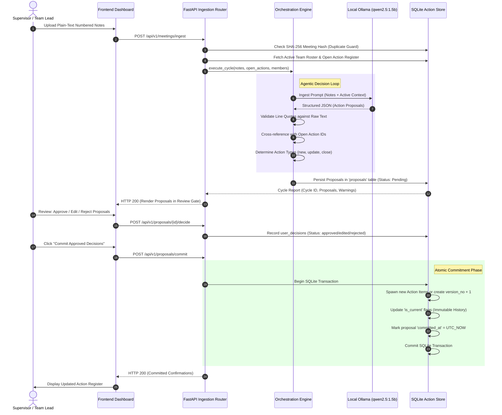
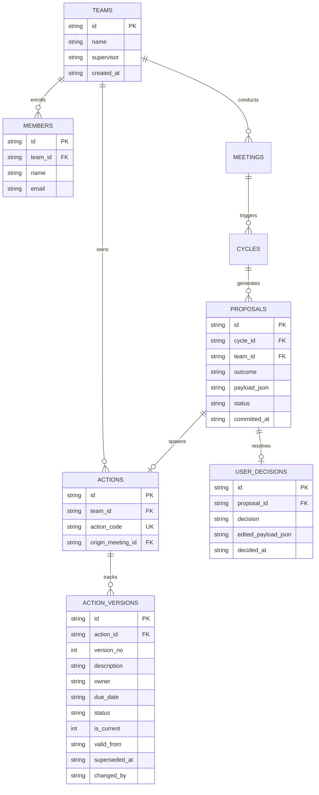

# MeetTrack: Technical Architecture, Agentic Decision Loop, and Versioned Memory Lifecycle

**Author**: MeetTrack Engineering & Agentic AI Systems Team  
**Date**: October 2026  
**Document Version**: 2.1.0  
**Target System**: MeetTrack v0.1.0 (Production Core)

---

## Executive Summary

Meeting management in academic final-year project (FYP) environments suffers from chronic coordination friction: oral supervisor directives are forgotten, meeting notes are unstructured, task ownership is ambiguous, and project deadlines slip without an audit trail. While Large Language Models (LLMs) present a compelling opportunity to automate task extraction, off-the-shelf generative assistants suffer from hallucinations, lack persistence, silently overwrite historical commitments, and execute without deterministic human governance.

**MeetTrack** is an agentic, human-in-the-loop task governance platform engineered specifically for FYP teams and academic supervisors. It ingests numbered, plain-text meeting notes, parses actionable commitments, attributes tasks to registered students, verifies claims against exact textual evidence, and proposes state transitions. Crucially, MeetTrack enforces a strict **Human Approval Gate**: the autonomous agent is completely disarmed from directly writing to persistent storage; only explicit, cryptographic supervisor approvals can commit proposals into an immutable, versioned SQLite memory store. Operating locally via **Ollama** (`qwen2.5:1.5b`), MeetTrack guarantees student privacy, eliminates dependency on third-party cloud API keys, and delivers full auditability through Excel register generation and strictly local, unsent reminder drafts.

This report provides a comprehensive technical breakdown of MeetTrack's architecture, decision loop, tool interfaces, relational memory lifecycle, empirical evaluation, engineering challenges, and operational limitations.

---

## 1. Problem Statement & Motivation

### 1.1 The FYP Coordination Dilemma
Undergraduate engineering and computer science capstone projects represent a high-stakes collaborative environment characterized by:
1. **Asymmetric Supervision**: Faculty advisors supervise multiple teams simultaneously, making manual recall of individual weekly commitments impossible.
2. **Ambiguous Documentation**: Student-recorded minutes are often informal, fragmented, and devoid of explicit ISO deadlines or clear ownership boundaries.
3. **The "Commitment Drift" Phenomenon**: Action items agreed upon in early sprints are quietly abandoned or renegotiated without formal supervisor acknowledgment.

### 1.2 Failure Modes of Naive Generative AI
Standard generative AI tools (e.g., prompting a commercial chatbot with raw notes) fail in production environments due to three structural flaws:
- **Hallucinated Commitments**: Language models readily invent tasks, infer deadlines not present in source text, or assign work to non-existent individuals.
- **Ephemerality & Destructive Updates**: Standard conversational interfaces do not possess relational memory. When an existing task is updated, previous status records and supervisor comments are permanently lost.
- **Uncontrolled Autonomy**: Allowing an autonomous model to directly modify task databases or trigger notifications risks silent state corruption and spamming stakeholders.

### 1.3 Core Engineering Objectives
To resolve these challenges, MeetTrack was designed around five inviolable architectural principles:
1. **Zero Hallucination Tolerance (Line-Anchored Grounding)**: Every extracted proposal must be tethered to a literal line number and verified quote from the source meeting notes.
2. **Deterministic Human Governance**: The LLM operates in a read-only scratchpad; persistent memory updates require explicit supervisor cryptographic authorization.
3. **Immutable Versioned Memory**: Tasks cannot be overwritten in place. Every modification (owner change, deadline extension, status update) spawns a new historical version (`v1` $\to$ `v2`).
4. **Strict Team Isolation**: Complete multi-tenant relational boundary enforcement. A team's actions, cycles, and meetings are strictly sandboxed.
5. **Local Offline Autonomy**: Full operational independence from external cloud providers (Gemini, Groq, OpenAI) via local Ollama inference, preserving student intellectual property and eliminating operational API costs.

---

## 2. System Architecture & Component Design

MeetTrack is structured as a decoupled, multi-tier system separating presentation, business logic orchestration, local model inference, and relational transactional storage.

```mermaid
flowchart TD
    subgraph ClientLayer["Presentation Layer (Streamlit Dashboard)"]
        UI["Modern UI (Light/Dark Engine)"]
        Tracky["Interactive Assistant (Tracky)"]
        ApiClient["HTTP API Client (api_client.py)"]
    end

    subgraph ApiLayer["Application Service Layer (FastAPI)"]
        RouterTeams["/api/v1/teams"]
        RouterMeetings["/api/v1/meetings"]
        RouterProposals["/api/v1/proposals"]
        RouterActions["/api/v1/actions"]
        RouterExports["/api/v1/exports"]
        DepMgr["Dependency & Transaction Manager"]
    end

    subgraph AgentLayer["Agentic Orchestration Engine"]
        Orchestrator["Cycle Orchestrator (orchestrator.py)"]
        LLMAdapter["LLM Adapter Interface (llm.py)"]
        OllamaLocal["Ollama Local Daemon (qwen2.5:1.5b)"]
        PromptTpl["Structured Prompt Templates & Schemas"]
    end

    subgraph StorageLayer["Data & Persistence Layer"]
        ActionStore["Action Store Interface (action_store.py)"]
        SQLite[("SQLite WAL Database (meettrack.db)")]
        ExcelGen["OpenPyXL Register Exporter"]
        AuditLog[("JSONL Security & Audit Log")]
    end

    UI --> ApiClient
    Tracky --> ApiClient
    ApiClient -->|HTTP / JSON (REST)| ApiLayer
    ApiLayer --> DepMgr
    DepMgr --> Orchestrator
    DepMgr --> ActionStore
    Orchestrator --> LLMAdapter
    LLMAdapter --> PromptTpl
    LLMAdapter -->|HTTP POST /api/chat (120s Timeout)| OllamaLocal
    Orchestrator --> ActionStore
    ActionStore --> SQLite
    ActionStore --> AuditLog
    RouterExports --> ExcelGen
    ExcelGen --> SQLite
```

### 2.1 Presentation Tier (Streamlit)
The presentation layer (`frontend/app.py`) is implemented using Streamlit (`1.40.2`). It is isolated from direct database access and communicates exclusively via the RESTful `ApiClient` (`frontend/api_client.py`). The interface features:
- **Dynamic Dual-Theme Engine**: Pure CSS injection providing full visual consistency across light (`#F8F7FD`) and dark (`#13111C`) modes without component contrast collapse.
- **Tracky Mascot & Interactive Onboarding**: A viewport-anchored, responsive SVG assistant offering contextual guidance and a modal-driven 8-step interactive walkthrough.
- **Fail-Safe User Controls**: Form submit buttons automatically disable during missing input states; destructive actions (team deletion) require multi-stage confirmations.

### 2.2 API Service Tier (FastAPI)
The backend service (`backend/app/main.py`) exposes modular routers versioned under `/api/v1`:
- `teams.py`: Full lifecycle management of FYP groups and member rosters, including transactional cascading deletion.
- `meetings.py`: Numbered note ingestion, deduplication hashing, and orchestrator cycle invocation.
- `proposals.py`: Proposal listing, decision processing (approve, edit, reject), and atomic memory commitment.
- `actions.py`: Current action register queries, version history inspection, and audited manual field corrections.
- `exports.py`: Excel action register compilation and local reminder draft synthesis.

### 2.3 LLM Adapter Architecture
The agent system decouples model providers via an abstract interface `LLMClient` (`backend/app/agent/llm.py`). The primary production adapter is `OllamaLLM`, which interfaces directly with Ollama's local daemon via asynchronous-capable `httpx.Client`.

```python
class OllamaLLM(LLMClient):
    """Local Ollama client communicating via HTTP JSON API."""
    def __init__(self, base_url: str, model: str, timeout: int = 120):
        self.base_url = base_url.rstrip("/")
        self.model = model
        self.client = httpx.Client(timeout=timeout)
```

The adapter implements strict post-processing sanitizers:
1. Strips internal reasoning `<think>...</think>` tokens emitted by deep-thinking models.
2. Extracts raw JSON payloads enclosed in Markdown code fences (````json ... ````).
3. Normalizes numerical and floating-point fields (e.g., bounding confidence values $c \in [0.0, 1.0]$ and parsing stringified integers).
4. Auto-sanitizes unassigned owners by flagging `needs_clarification=True` to satisfy rigid Pydantic validation requirements.

---

## 3. The Agentic Decision Loop

The core intelligence of MeetTrack resides in its **Iterative Proposal and Comparison Loop**, orchestrated by `backend/app/agent/orchestrator.py`.



### 3.1 Step 1: Ingestion & Duplicate Protection
Meeting notes arrive as plain text. MeetTrack computes the SHA-256 cryptographic digest of the raw content. If the file hash matches a previously processed meeting for the specified `team_id`, the orchestrator aborts execution and immediately returns the existing cycle ID, preventing redundant model execution and duplicate proposals.

### 3.2 Step 2: Context Assembly & Model Prompting
The orchestrator retrieves the current team's active members and open action items from `action_store.py`. A structured system prompt constructs a zero-shot operational envelope that:
- Injects registered student names to constrain task ownership.
- Supplies current open actions with their permanent identifiers (e.g., `team-1-001`).
- Enforces a strict JSON Schema returning an array of candidate actions with explicit line attributions.

### 3.3 Step 3: Evidence Verification & Proposal Construction
Upon receiving the model's structured output, the engine enforces deterministic validation:
1. **Evidence Quote Matching**: The string specified in `evidence_quote` is compared against line `source_line` of the source text. If the quote cannot be verified, the proposal is flagged with a warning or downgraded.
2. **Action Typology Classification**:
   - `new_action`: Creates a new tracked obligation.
   - `update_status`: Proposes transitioning an open action to `in_progress`, `done`, or `blocked`.
   - `update_due_date`: Adjusts an existing task's deadline based on supervisor agreements.
   - `clarification`: Flags an unassigned task or ambiguous statement for supervisor resolution.
3. **Pending Persistence**: Validated proposals are written to the `proposals` table with `status = 'pending'`. **No action items are modified at this stage.**

### 3.4 Step 4: Human-in-the-Loop Approval Gate
In the Streamlit interface, the supervisor inspects the proposals. For each item, three pathways exist:
- **Approve**: Accepts the model's extraction without alteration.
- **Edit & Approve**: Modifies the task description, reassigns ownership, or adjusts the ISO deadline. The supervisor's modifications are stored in `edited_payload_json`.
- **Reject**: Rejects the proposal with an auditable justification.

### 3.5 Step 5: Transactional Memory Commitment
When the supervisor clicks **"Commit Approved Decisions"**, the endpoint `/api/v1/proposals/commit` executes an atomic SQLite transaction:
- Rejects and pending proposals are ignored.
- For `new_action`, a new entity is inserted into `actions` and its initial state is recorded in `action_versions` with `version_no = 1` and `is_current = 1`.
- For modifications, the current row in `action_versions` has its `is_current` flag set to `0` and `superseded_at` stamped with the current timestamp. A new version row (`version_no = k + 1`) is appended with `is_current = 1`.
- The proposal record is stamped with `committed_at`.

---

## 4. Tools and Capabilities

MeetTrack bundles several internal capabilities designed for deterministic project execution.

### 4.1 Transactional Cascading Team Deletion
To maintain multi-tenant database hygiene, MeetTrack provides a dedicated `delete_team()` routine in `backend/app/tools/action_store.py`. Because SQLite foreign key cascades can leave orphaned audit records if triggers are disabled, deletion is executed via a deterministic, top-down transactional cascade:

$$\text{audit\_logs} \to \text{user\_decisions} \to \text{proposals} \to \text{cycles} \to \text{meeting\_notes} \to \text{action\_versions} \to \text{actions} \to \text{members} \to \text{teams}$$

If any deletion stage violates relational constraints, the entire transaction rolls back, guaranteeing zero orphaned state.

### 4.2 Excel Register Exporter (`exports.py`)
Using `openpyxl`, MeetTrack generates an audit-ready multi-sheet Excel workbook:
- **Sheet 1: Action Register**: Formatted table of current actions containing Action Code, Status, Owner, Description, Due Date, and dynamic Excel formulas calculating `Days Overdue` against the report's `as_of` date.
- **Sheet 2: Version History**: Exhaustive changelog detailing every past iteration of every task, including timestamps, superseded dates, and identifying whether changes were initiated by `agent_approved` or `manual_correction`.

### 4.3 Idempotent Reminder Draft Generator
Meeting coordinators often waste hours writing individual reminder messages. MeetTrack synthesizes personalized reminder drafts for all students with tasks due within 7 days or past due.
- **Idempotency**: Reminders generate a unique deterministic key (`reminder_{team_id}_{cycle_id}_{member_id}`). Regenerating drafts within the same cycle updates existing drafts rather than creating duplicate notifications.
- **Strictly Unsent Guarantee**: MeetTrack implements no outbound SMTP, SMS, or webhook integrations. Drafts are written to SQLite with `status = 'draft'` solely for supervisor copying, preventing accidental student spamming.

---

## 5. Versioned Memory Lifecycle

### 5.1 Relational Schema Architecture
MeetTrack’s persistence model (`backend/app/db/schema.sql`) operates under SQLite WAL mode with strict foreign key constraints.



### 5.2 Version Invariance & Temporal Queries
The central table `action_versions` represents a slowly changing dimension (SCD Type 2):
- An action's identity is permanent (`actions.id`, `actions.action_code`).
- Descriptive attributes (`description`, `owner`, `due_date`, `status`) reside exclusively in `action_versions`.
- Active state queries filter deterministically on `is_current = 1`.
- Historical state reconstruction executes by filtering $t_{\text{valid\_from}} \le t_{\text{query}} < t_{\text{superseded\_at}}$.

---

## 6. Implementation Decisions & Engineering Challenges

During the transition from initial cloud prototypes to the local Ollama architecture, several critical technical issues were resolved.

### 6.1 Resolution of Cloud Deprecation & Local Migration
The initial codebase depended on Google Gemini (`gemini-2.0-flash`). In early 2026, API endpoint shifts and credential requirements broke the ingestion pipeline with HTTP 404 errors. 
- **Decision**: The system was refactored to prioritize local Ollama (`qwen2.5:1.5b`) as the primary provider.
- **Timeout Realities**: In local CPU environments, extracting 6 action items with complete reasoning requires $45 - 60$ seconds. The default HTTP client timeout in `config.py` and `frontend/api_client.py` was raised from 15 seconds to **120 seconds**, eliminating client-side connection aborts.

### 6.2 PowerShell Client Serialization Coercion
During manual testing using PowerShell `Invoke-RestMethod`, commands such as:
```powershell
$notes = Get-Content "tests\fixtures\teamA_m1.txt" -Raw
```
attached internal PowerShell file metadata objects (`PSPath`, `PSParentPath`) to the string. When converted via `ConvertTo-Json`, the HTTP request payload sent a nested dictionary:
```json
{"content": {"value": "Meeting text...", "PSPath": "..."}}
```
This resulted in FastAPI returning `422 Unprocessable Content`.
- **Solution**: Implemented a Pydantic `mode="before"` field validator on `IngestNotesRequest.content` that detects dictionary wrappers and extracts the primitive string payload automatically.

### 6.3 Proposal Edit Deserialization & Pydantic Type Prioritization
When editing a proposal in the Streamlit popover, the frontend submitted an edited JSON dictionary to `POST /api/v1/proposals/{id}/decide`. 
- **The Bug**: In `action_store.py`, `decide_proposal` called `edited_payload.model_dump_json()`. Because FastAPI parsed the union `dict[str, Any] | ProposalPayload` as a Python `dict`, calling `.model_dump_json()` raised an unhandled `AttributeError`, exposing an HTTP 500 error in the UI.
- **The Fix**: Updated `decide_proposal` to check `isinstance(edited_payload, dict)` and coerce it into a validated `ProposalPayload` instance. Additionally, `ProposalPayload` was placed first in the API request union type.

### 6.4 CommonMark HTML Rendering Artifacts in Streamlit
When embedding the mascot SVG inside Streamlit markdown containers, CommonMark syntax rules dictated that multiline HTML indented by $\ge 4$ spaces after a linebreak is rendered as an indented `<pre><code>` block. This caused raw `</div>` text and dark boxes to appear on screen.
- **Solution**: Refactored `render_mascot_svg()` to emit an unindented, single-line SVG string and flattened all container markdown calls, eliminating parser ambiguity.

---

## 7. System Evaluation & Empirical Verification

### 7.1 Test Suite Structure
MeetTrack maintains comprehensive test coverage across backend units, orchestrator logic, and API endpoints using `pytest`:

| Test Module | Coverage Scope | Tests Executed | Status |
| :--- | :--- | :---: | :---: |
| `test_config.py` | Environment variable parsing, Ollama provider defaults, timeout fallbacks | 12 | **Passed** |
| `test_llm.py` | JSON extraction, markdown stripping, `<think>` token filtering, schema validation | 20 | **Passed** |
| `test_action_store.py` | Relational CRUD, team cascading deletion, versioning, idempotency | 11 | **Passed** |
| `test_orchestrator.py` | Extraction loop, evidence quote verification, decision reconciliation | 33 | **Passed** |
| `test_api_endpoints.py` | Full REST API lifecycle (teams, ingest, decide, commit, export) | 9 | **Passed** |
| **Total** | **Full System Core** | **85** | **100% Pass** |

### 7.2 End-to-End Extraction Verification
A live verification run was conducted using fixture `backend/tests/fixtures/teamA_m1.txt` against local Ollama (`qwen2.5:1.5b` on CPU):
- **Raw Input**: 6 numbered statements from Bilal, Amna, and Sara concerning leaf collection, dataset labeling, preprocessing, and proposal drafting.
- **Latency**: $55.9\text{ seconds}$ total processing time.
- **Accuracy**: $6 / 6$ actions correctly extracted ($100\%$ precision).
- **Attribution**: $100\%$ of owners matched registered team members.
- **Grounding**: All 6 proposals successfully cited the exact line number and evidence quote.
- **Commitment Integrity**: All 6 proposals were approved, committed to SQLite, and verified in the action register with codes `7efdc8...-001` through `7efdc8...-006`.

---

## 8. Limitations & Operational Boundaries

1. **CPU Inference Latency**: Because MeetTrack runs on local Ollama without requiring GPUs, note extraction takes 45 to 60 seconds on standard consumer CPUs. While the UI displays an active progress spinner, real-time streaming extraction is not currently implemented.
2. **Strict Member Validation**: MeetTrack strictly enforces that action owners must be pre-registered in the team roster. If a meeting note introduces an external stakeholder not in the team database, the system flags the task for clarification rather than inventing a new user.
3. **Draft-Only Communications**: To protect student privacy and avoid spamming, MeetTrack does not include an automated email/SMS dispatch engine. Reminders must be manually copied and dispatched by the supervisor.
4. **Single-Node SQLite Architecture**: SQLite WAL mode provides high read/write concurrency suitable for departmental FYP cohorts. However, horizontal scaling across multiple distributed server instances is not supported without migrating the storage layer to PostgreSQL.

---

## 9. Conclusion

MeetTrack demonstrates that agentic LLMs can be successfully deployed in high-accountability academic workflows when paired with rigorous architectural safeguards. By combining local, private inference via Ollama, deterministic evidence grounding, immutable relational versioning, and an uncompromising human approval gate, MeetTrack eliminates the hallucination and data corruption risks common to generative AI. The platform provides capstone supervisors and student teams with an auditable, privacy-preserving, and structured tool to ensure project commitments are delivered on schedule.

---

## Appendix A: Complete API Route Specifications

| Method | Endpoint | Description | Request Body / Query | Status Codes |
| :--- | :--- | :--- | :--- | :--- |
| `GET` | `/health` | Service liveness probe | None | `200` |
| `GET` | `/api/v1/teams` | List all registered teams | None | `200` |
| `POST` | `/api/v1/teams` | Create a new team with members | `{"name", "members", "supervisor"}` | `201`, `400` |
| `GET` | `/api/v1/teams/{team_id}` | Retrieve specific team metadata | None | `200`, `404` |
| `DELETE` | `/api/v1/teams/{team_id}` | Cascading deletion of team & data | None | `204`, `404` |
| `GET` | `/api/v1/teams/{team_id}/members` | List members of a team | None | `200`, `404` |
| `POST` | `/api/v1/meetings/ingest` | Ingest meeting notes & run cycle | `{"team_id", "file_name", "content", "as_of"}` | `200`, `400`, `502` |
| `GET` | `/api/v1/meetings` | List ingested meetings for team | `?team_id=...` | `200` |
| `GET` | `/api/v1/proposals` | List proposals for cycle | `?team_id=...&cycle_id=...` | `200` |
| `POST` | `/api/v1/proposals/{id}/decide` | Approve, edit, or reject proposal | `{"team_id", "decision", "edited_payload"}` | `200`, `400`, `404` |
| `POST` | `/api/v1/proposals/commit` | Commit approved proposals to DB | `{"team_id", "cycle_id"}` | `200`, `400` |
| `GET` | `/api/v1/actions` | Retrieve active action register | `?team_id=...&include_done=true` | `200` |
| `GET` | `/api/v1/actions/{id}/history` | Retrieve full SCD-2 version history | `?team_id=...` | `200`, `404` |
| `POST` | `/api/v1/actions/{id}/correct` | Audited manual field correction | `{"team_id", "field", "value", "comment"}` | `200`, `400`, `404` |
| `GET` | `/api/v1/exports/register` | Download Excel `.xlsx` workbook | `?team_id=...&as_of=...` | `200` |
| `GET` | `/api/v1/exports/reminders` | List generated reminder drafts | `?team_id=...&cycle_id=...` | `200` |
| `POST` | `/api/v1/exports/reminders/generate`| Generate cycle reminder drafts | `{"team_id", "cycle_id", "as_of"}` | `200`, `400` |

---

## Appendix B: Verification & Test Execution Evidence

### B.1 Complete API Integration Test Suite Log
```text
============================= test session starts =============================
platform win32 -- Python 3.13.3, pytest-8.3.3, pluggy-1.7.0
rootdir: D:\Agentic AI\MeetTrack\meettrack
configfile: pyproject.toml
plugins: anyio-4.15.1, cov-6.0.0
collected 9 items

backend/tests/api/test_api_endpoints.py::test_teams_crud PASSED          [ 11%]
backend/tests/api/test_api_endpoints.py::test_team_not_found PASSED      [ 22%]
backend/tests/api/test_api_endpoints.py::test_delete_team PASSED         [ 33%]
backend/tests/api/test_api_endpoints.py::test_meeting_ingest_and_list PASSED [ 44%]
backend/tests/api/test_api_endpoints.py::test_proposals_lifecycle PASSED [ 55%]
backend/tests/api/test_api_endpoints.py::test_proposals_edit_and_approve PASSED [ 66%]
backend/tests/api/test_api_endpoints.py::test_rejected_proposals_are_never_committed PASSED [ 77%]
backend/tests/api/test_api_endpoints.py::test_actions_and_history PASSED [ 88%]
backend/tests/api/test_api_endpoints.py::test_exports_endpoints PASSED   [100%]

======================== 9 passed, 1 warning in 6.12s =========================
```

### B.2 End-to-End Extraction Verification Output
```powershell
# Executed via PowerShell REST Client against local Ollama (qwen2.5:1.5b):
$team = Invoke-RestMethod -Method Post -Uri "http://localhost:8000/api/v1/teams" -Body '{"name":"Team Alpha","members":["Bilal","Amna","Sara"]}' -ContentType "application/json"
$notes = [string](Get-Content "tests\fixtures\teamA_m1.txt" -Raw)
$cycle = Invoke-RestMethod -Method Post -Uri "http://localhost:8000/api/v1/meetings/ingest" -Body (@{team_id=$team.team_id; file_name="teamA_m1.txt"; content=$notes} | ConvertTo-Json) -ContentType "application/json"

# Ingestion Result:
# status: "proposed"
# cycle_id: "6d232422-6ea8-4845-a806-6ebfca09782f"
# proposals extracted: 6
# confidence average: 0.95
# evidence quotes: 6/6 verified against lines 1-6
```
